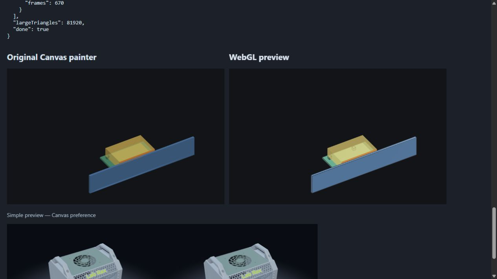
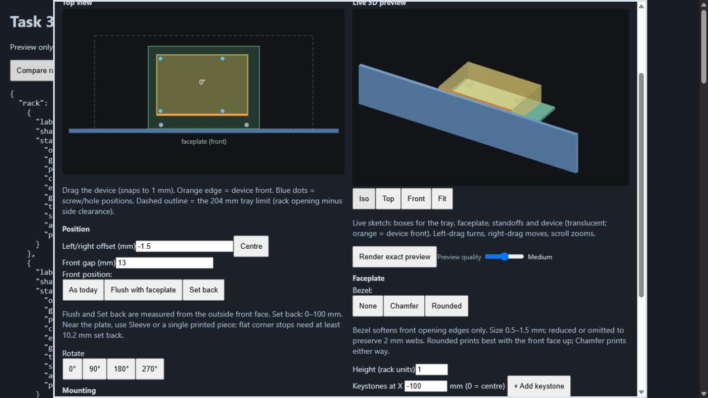
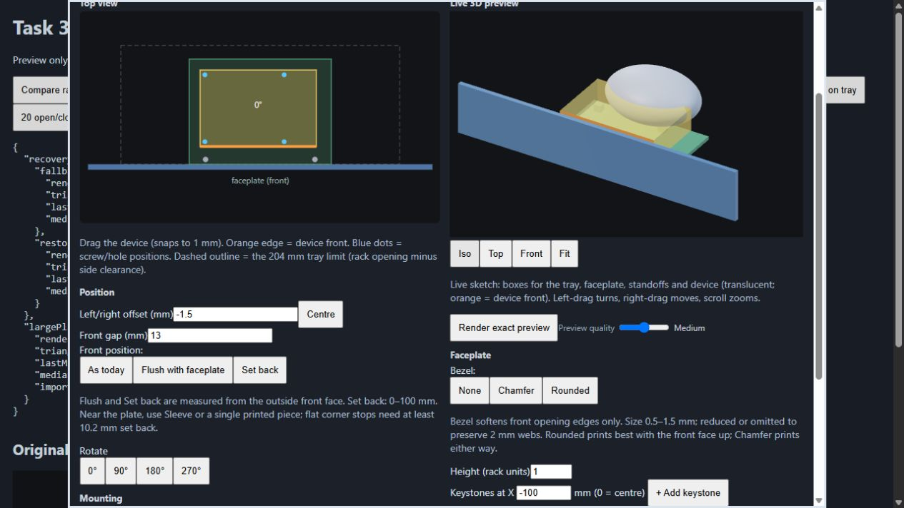
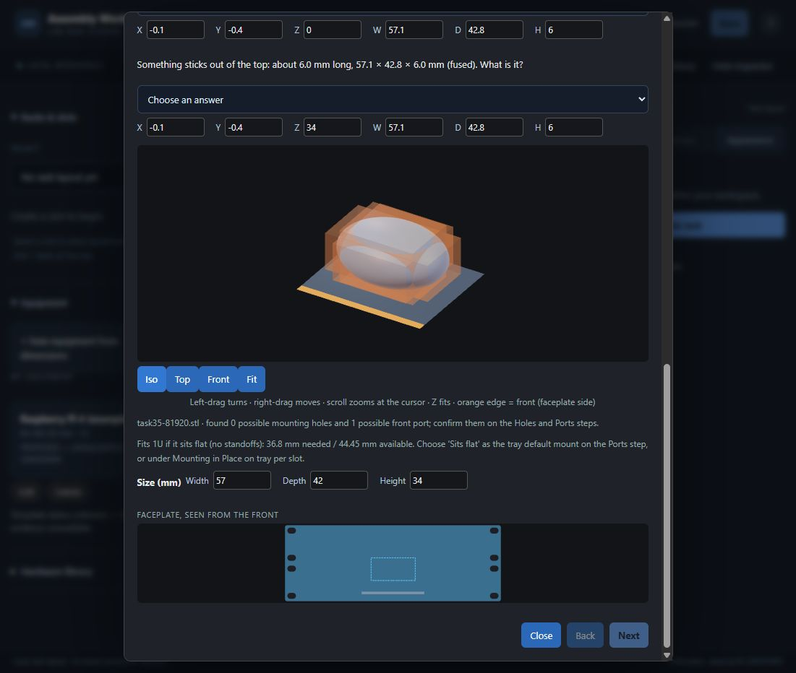

# Task 35 — implementation report

2026-10-22. Implemented in **D:\Projects\assembly-workshop** for Claude review. No commit or push.

## Changes

- EquipmentPainter keeps draw/bind/parseStl, adds paint2d/dispose/stats, and coalesces draw requests into one requestAnimationFrame. The original painter body is unchanged (checked against the byte-for-byte archive, ignoring surrounding whitespace only).
- Added LabRaxStudio.PreviewRenderer and pure previewCamera/previewSwitch/featureEdges/median helpers. The helper uses the rack's **same VS/FS shaders and programFor/loc/upload/submit/textureSettings methods**. Existing rack code before the new helper is unchanged; no changes to Renderer.draw or shaders.
- One offscreen WebGL canvas/context per visible preview canvas; it is copied into the existing 2D canvas, preserving its controls and allowing immediate Canvas fallback without replacing the DOM canvas. Normals and buffers are prepared on geometry changes. Array/version identity caching also reuses equivalent recreated tray sketches. Unused GPU geometry is deleted.
- Depth test, opaque first, translucent sets sorted by their vertex-average centre, depth writes disabled for translucency. High adds cached >30° feature edges on opaque sets. Small previews use the rack lighting with shadows/AO disabled at every quality (optional in the spec).
- Preference, context loss, unavailable WebGL and frame-budget fallbacks; one-line status under each preview. Ten-frame median thresholds: >16 ms lowers High→Medium→Low; >33 ms at Low chooses Canvas for the window. A deliberate slider change resets adaptation; preferences/saved data are never changed by adaptation.
- Low uses the existing simplification cell; pixel-ratio scales match RenderQuality. Stats report renderer/triangles/lastMs/medianMs. Canvas stats count input triangles, including at Low; WebGL stats count the simplified drawn triangles. Both interpretations are stated here to avoid treating Low counts as equivalent.
- Dialog close and detached canvases release GPU buffers/program/texture and request context loss. Tray placement has only its explicit dispose hook changed; its geometry and placement logic are untouched.
- Tests registered in js-tests/run.js; manifest hashes refreshed. Byte-for-byte originals are in docs/archive/codex/2026-10-22/task35/.

## Verification actually performed

1. `git pull` first: sandbox attempt failed (`must be run in a work tree`); retry with approved D: access: **Already up to date**. Initial `git status --short`: clean.
2. Read AGENTS.md, PROJECT.md, HANDOFF.md, ROADMAP.md, standing rules, task file and matching prompt.
3. `& ./outputs/Mechanical_Design_App/run_checks.ps1` **before edits: PASS**.
4. `node --test outputs/Mechanical_Design_App/js-tests/preview-webgl.js`: **5/5 PASS**. Tests cover GPU-matrix projection vs original P (<0.5 px), switch boundaries, upload cache (including recreated arrays/version change), cube 12 edges/subdivided square 4, and on-demand idle/coalescing/disposal/recovery behavior.
5. Full run_checks **after implementation: PASS**. Final retained run: **177 Python tests (one skip), 227 JavaScript tests, zero failures**. See [full output](../../outputs/Mechanical_Design_App/js-tests/task35-checks.txt). No OpenSCAD render/export was run.
6. Browser app launched with Python 3.10 `-B outputs/Mechanical_Design_App/app.py --data C:\Users\brian\AppData\Local\Temp\assembly-task35-34d694036bc64293820f775728a9eb01 --port 8835`. New temporary data only. A separate loopback-only browser fixture on **8836** serves local preview sources/test code and blocks data paths. It never reads data/normal-use.
7. Real Place on tray component opened with example fixture; Iso and Top buttons checked. Large stress STL: locally generated synthetic ellipsoid, **81,920 triangles**, encoded to binary STL then parsed with EquipmentPainter.parseStl. Five-second scripted yaw sweep for each of the 12 renderer/quality/device combinations. No internet assets or dependencies.
8. Actual disposable app wizard import also checked with a temporary 4,096,084-byte binary STL: preview canvas `#ewModel` reported `data-renderer=webgl`. Import/detection took a very long time (the chooser/check tool call returned after about 46.9 minutes); this was outside the measured draw sweep. No import/detection changes were made in this task. Nothing saved to the equipment library or rack.
9. Real Place on tray stress fixture injects the parsed large mesh into its preview sets only. It deliberately leaves the original example's form/spec unchanged. This tests the large renderer workload inside the actual component; it is not a new manufacturing item or an end-to-end saved equipment placement.
10. **20 open/close cycles:** 20 contexts created, 20 disposed, 0 live; all 20 GL contexts reported isContextLost after disposal. No browser graphics errors/warnings observed.
11. Actual WEBGL_lose_context test: stats switched to Canvas on loss, then back to WebGL on restore, using the same preview context. See [recovery evidence](../../outputs/Mechanical_Design_App/js-tests/task35-evidence/task35-recovery-large.json).
12. Depth readback check: a red device above a blue tray, drawn in both submission orders, was red from above and blue from below. All four checks pass. Visual inspection showed expected tray/standoff/device occlusion. Translucent device boxes intentionally remain see-through; physical fit/strength remain UNKNOWN. See [depth and lifecycle evidence](../../outputs/Mechanical_Design_App/js-tests/task35-evidence/task35-lifecycle-depth.json).

## Timings

ChatGPT in-app browser, 560×350 CSS px preview. Medians are the last ten measured JavaScript draw-and-copy calls, including synchronous upload work when applicable. They are **not GPU timer-query timings or end-to-end frame latency**. Canvas rows use the unchanged original painter. Low reduces geometry; no frame-budget downgrade occurred in this sweep. Exact raw samples/row stats: [JSON](../../outputs/Mechanical_Design_App/js-tests/task35-evidence/task35-browser-results.json).

| Device | Requested renderer | Quality | Reported renderer | Stats triangles | Median ms | Last ms | Draws / 5 seconds |
| --- | --- | --- | --- | ---: | ---: | ---: | ---: |
| example | canvas | low | canvas | 96 | 0.20 | 0.20 | 716 |
| example | canvas | medium | canvas | 96 | 0.20 | 0.20 | 718 |
| example | canvas | high | canvas | 96 | 0.20 | 0.20 | 718 |
| example | webgl | low | webgl | 88 | 0.15 | 0.10 | 718 |
| example | webgl | medium | webgl | 96 | 0.15 | 0.00 | 718 |
| example | webgl | high | webgl | 96 | 0.10 | 0.10 | 717 |
| large STL | canvas | low | canvas | 82,016 | 80.45 | 109.50 | 58 |
| large STL | canvas | medium | canvas | 82,016 | 546.30 | 533.90 | 10 |
| large STL | canvas | high | canvas | 82,016 | 545.15 | 811.00 | 10 |
| large STL | webgl | low | webgl | 12,376 | 0.10 | 0.20 | 717 |
| large STL | webgl | medium | webgl | 82,016 | 0.10 | 0.20 | 709 |
| large STL | webgl | high | webgl | 82,016 | 0.15 | 0.00 | 670 |

## Rack pixel comparison

Same local 5U source-mesh scene, panels enabled, no equipment allocations, 800×600 pixels, yaw .55, pitch .65, zoom 1, perspective, shadows + AO enabled. Archived and current rack Renderer each drew **115,678 triangles / 24 objects**. `readPixels(RGBA, UNSIGNED_BYTE)` SHA-256:

- Before: `bb09299245cd809a97c1c4ffe2190bb0ad742c63631ab9292cd2cf64ea89d41d`
- After:  `bb09299245cd809a97c1c4ffe2190bb0ad742c63631ab9292cd2cf64ea89d41d`
- **Identical**. The fixture keeps lighting/logo input identical. This proves this scene/camera on this browser, not all possible scenes/devices.

## Screenshots

Original Canvas vs WebGL, same camera and example sketch (left/right):

Actual Place on tray component:

Large parsed STL stress inside Place on tray:

Actual app wizard after large STL chooser import:

## Limits and open questions

- No decision needed to review this implementation. Claude should assess the lighting and High feature-edge appearance on a representative real equipment mesh.
- No physical validation, no changed STL/SCAD/spec/saved-data behavior, no renderer changes to the rack path. The large synthetic mesh exists only in the temporary acceptance folder and test memory.
- Translucency is sorted by set centre as requested, so intersecting translucent surfaces still have ordinary set-order blending limits. Opaque geometry uses the depth buffer.
- CPU timings are deliberately scoped to stats. First upload/edge extraction can be slower than the steady-state median. The slow synthetic wizard detection observed above remains an unrelated performance question outside the May change list.
- Browser timing and Place tests use the production component in a standalone local fixture; they do not save/import a stress item into active user data. The actual app wizard import was additionally checked on the new --data folder.
- No commit, push, release, upload to an external service, printing, OpenSCAD build/export, new dependency, or internet asset. Port 8765 and the old C: project copy were not touched. HANDOFF/ROADMAP were left unchanged because they are outside this task's May change list.

## Changed files and SHA-256

Hashes are raw file bytes (not LF-normalized manifest hashes). Existing files were archived before editing. New evidence/tests have no before hash; this report's own self-referential hash is omitted.

| File (under outputs/Mechanical_Design_App/) | Before SHA-256 | After SHA-256 |
| --- | --- | --- |
| `equipment-wizard.js` | `652fcf53e0c60fc32ffaa122bc736cedf08d5b839497a108becdaac2e57838b8` | `926dbf8f89488afa7afee2216d04bed2528086e88e6a9a0c83cea1948fd7e435` |
| `rack-studio.js` | `060060b7698d7d836d2dccedac8c06dfce015128b35c635ad00f04a43fbe3e4f` | `b3446fd5e0a25d994a43b538f3fddb0ca80f75bcaa1e733f8c98c613321af9b9` |
| `tray-placement.js` | `b092bf6ebb81c837b124b14c6395fb19a9f36afdd0cc4d8729f6751ccd09824d` | `ba61ac468cf13147b88220079fae1d009c02a6bc08802289fe26f9ad81f3d34f` |
| `asset-manifest.json` | `3208b9e2a8ea147ea36bce7dd148c3cb5ef2d220df9ce088b459b76e5760562c` | `5b95f59a27bda3a074e65961865e6a4bcef979610444b3f08f2cce7c385e1326` |
| `js-tests/run.js` | `a303526727813acba65de769821f1566492e181d391222b7aac474c419872d82` | `ba4522929dadcd1e75af39741dd3da15d5778fe825ff550220d52a2e2ea647ac` |
| `js-tests/preview-webgl.js` | `NEW` | `b32eaaf1ae91d7a7c910e497f723683efd09f65fe8fe651b60a3ac8131d5e695` |
| `js-tests/task35-browser.html` | `NEW` | `897c16b9f63cc46d298c0d40c44967e9e0fcbdf69ab86620682f4bcb8bbbfd53` |
| `js-tests/task35-browser-server.py` | `NEW` | `56321183ff33e76181847f5df05f67672a5a3779f3188595168d5b8d5fdd18ac` |
| `js-tests/task35-checks.txt` | `NEW` | `7b4421ca2c5315c742d702df8e74f144fc665f18c295b04fd98b9fa6e139b8fe` |
| `js-tests/task35-evidence/task35-browser-results.json` | `NEW` | `e2964a6334b001aec3613f8b6b982f4edd223796b89b77e41ea7ecbc6c97064d` |
| `js-tests/task35-evidence/task35-comparison.jpg` | `NEW` | `d9178a11deaccbcc4fd450650498fc0afbc838081b0249176b15df37bdb54cd8` |
| `js-tests/task35-evidence/task35-large-place.jpg` | `NEW` | `41ddcf808d062e3fdb95db8da692c10976c98d9ad74a9aa2d3a14a54f910fe8d` |
| `js-tests/task35-evidence/task35-lifecycle-depth.json` | `NEW` | `099eed1ec82577a2c395d3e45997cd93cbe89d49442fdec8679b080904f8160e` |
| `js-tests/task35-evidence/task35-place-on-tray.jpg` | `NEW` | `1140e670c58fb6798524eade6f63933a1c6076cadb9a27e76433ea7e8de149dc` |
| `js-tests/task35-evidence/task35-recovery-large.json` | `NEW` | `5c68eba6d73cf959fcb10515fb95c48559c48de5190432e434b5da75bf84be19` |
| `js-tests/task35-evidence/task35-wizard-large.jpg` | `NEW` | `8c737407299d06cda3a196136e6c1c5a127df3e92d82d816a501c675f9de7e7d` |

Cleanup: closed both task-created browser tabs and stopped only verified task servers 8835 (PID 44216) and 8836 (PID 30356). Temporary acceptance data was preserved. git diff --check passed. No commit or push.
