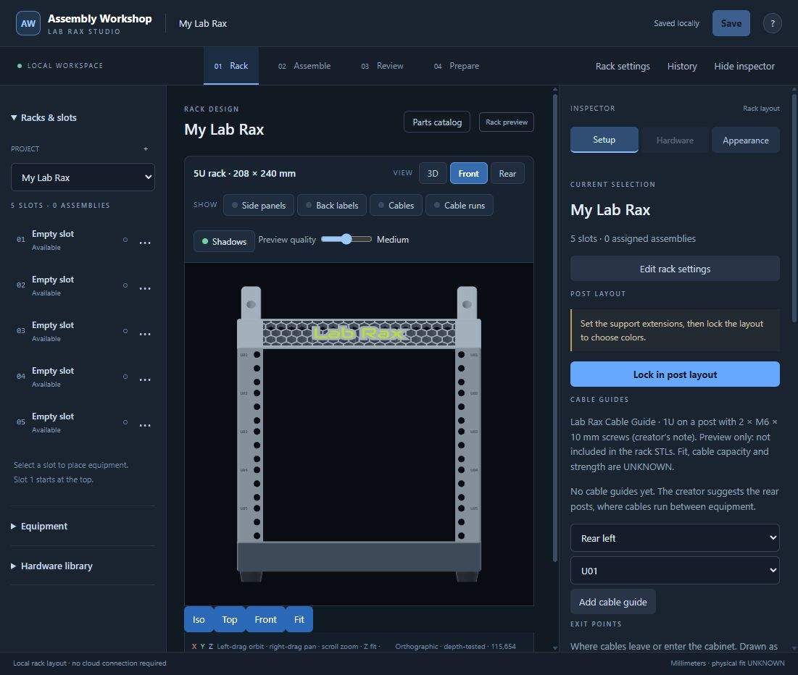
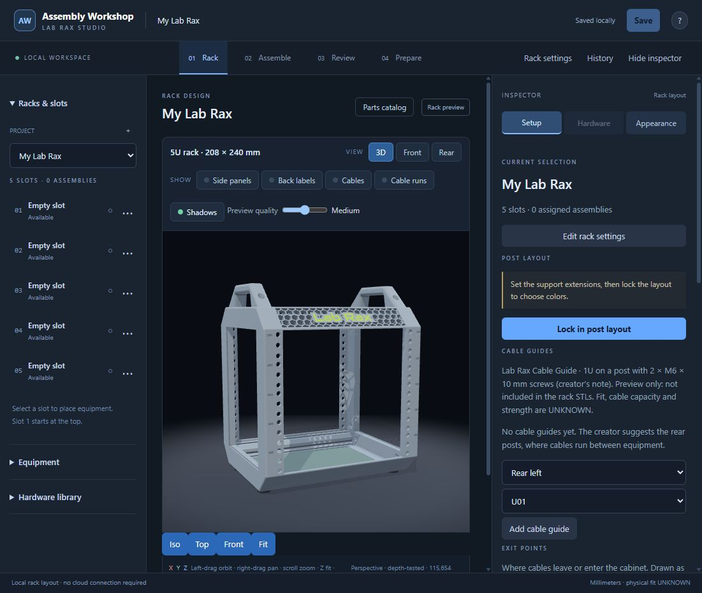

# Task 37 — rack feet and preview floor

2026-10-22. Implemented in `D:\Projects\assembly-workshop`; ready for Claude review. No commit or push.

## Result and cause

Measured before editing: every source foot reaches **Z = -47 mm**. The old floor top was **-42 mm**, cutting through the bottom 5 mm of the feet. The new floor top is **-47.65 mm**, giving the specified 0.65 mm gap. The rack parts and source poses are unchanged.

`rack-studio.js` now computes world-space bounds from triangle-referenced vertices of the renderer's actual objects, including local/inline equipment meshes and visible translucent parts. Empty meshes and unused vertices do not lower the floor. Bounds are cached by immutable mesh identity and rotation; translation is applied each draw. The pure `floorTop(bounds)` helper returns the lowest finite Z minus 0.65, or -42 with no usable bounds.

The floor remains a 1 mm box with X = -900..900 and Y = -700..900, the same material, color and shader. Its geometry is built at local Z = -1..0 and translated each draw to the computed top, so a scene change does not leave a stale GPU floor buffer. Inspection viewers that supply their own absolute-Z floor mesh get an offset relative to that mesh's top. `workspace.js` did not need changing.

Shadow framing includes visible part bounds and the new floor height, without framing the floor's huge X/Y rectangle. Shadow/depth cache keys include floor height, object rotations and the light matrix. The rack shader's floor fade uses only XY distance (`vec2(0.,120.)`, thresholds 220/600); it has **no Z=-42 assumption or uFloorParams uniform**, so its look remains unchanged. The inspection adapters' existing `floorParams` arrays also contain XY center/span, not floor Z.

**Pick plane left unchanged:** `(-3-ray.origin[1])/ray.direction[1]` intersects **Y=-3**, the vertical front slot-selection plane. It is not the horizontal Z floor; `workspace.js` draws the slot overlay at that same Y=-3 plane.

## Measurement

New disposable data: `C:\Users\brian\AppData\Local\Temp\assembly-task37-81edd696669c46fd8b0606fedaf5150b`, port **8847**, process **55192**. A new 5U rack with no equipment was created and saved there through the browser. Measurement used `LabRaxScene.frame(5,true)` and each source vertex transformed by the part's unchanged R/t; default 5U `rackFrame` has the same placements (post construction order differs). Initial screenshots have side panels off; the two optional side panels are included below and were also toggled on after the fix. All other parts are visible in both states. Raw results: [measurements.json](37-rack-floor-feet-evidence/measurements.json).

| Source scene index | Part | Kind | Translation X, Y, Z (mm) | Minimum world Z (mm) |
| --- | --- | --- | --- | ---: |
| 0 | beam_bottom | frame | 0, 27.425, -7.575 | -35.00000310 |
| 1 | beam_bottom | frame | 0, 212.575, -7.575 | -35.00000310 |
| 2 | side_rail | frame | -125.98, 120, -17.5 | -35.00000000 |
| 3 | side_rail | frame | 125.98, 120, -17.5 | -35.00000000 |
| 4 | panel_bottom | panel | 0, 120, -31.5 | -32.99999905 |
| 5 | foot | foot | -124.73, 55, -41 | -47.00000000 |
| 6 | foot | foot | -124.73, 185, -41 | -47.00000000 |
| 7 | foot | foot | 124.73, 55, -41 | -47.00000000 |
| 8 | foot | foot | 124.73, 185, -41 | -47.00000000 |
| 9 | post5 | frame | -125.98, 17.5, 111.125 | 0.00000000 |
| 10 | post5 | frame | 125.98, 17.5, 111.125 | 0.00000000 |
| 11 | post5 | frame | -125.98, 222.5, 111.125 | 0.00000000 |
| 12 | post5 | frame | 125.98, 222.5, 111.125 | 0.00000000 |
| 13 | panel5 | side | -138.48, 120, 111.125 | -2.94999700 |
| 14 | panel5 | side | 138.48, 120, 111.125 | -2.94999700 |
| 15 | beam_top_front | frame | 0, 27.425, 229.825 | 202.39999690 |
| 16 | beam_top_rear | frame | 0, 212.575, 229.825 | 202.39999690 |
| 17 | side_rail | frame | -125.98, 120, 239.75 | 222.25000000 |
| 18 | side_rail | frame | 125.98, 120, 239.75 | 222.25000000 |
| 19 | panel_top | panel | 0, 120, 253.75 | 252.25000000 |
| 20 | handle | frame | -124.789, 120, 276 | 257.25000000 |
| 21 | handle | frame | 124.789, 120, 276 | 257.25000000 |

All four feet have local min Z=-6 and translation Z=-41. Scene min Z=-47; old top=-42; new top=-47.65. With feet removed in automated tests, the bottom beams become lowest at -35.00000310, giving floor top -35.65000310. No feet-off option exists in the current rack UI, so no browser screenshot claims to test that state.

## Browser evidence

Only `http://127.0.0.1:8847/` was used. No access to user data or the live server on 8765. Screenshots use the saved disposable 5U rack, shadows on, medium preview quality. Both low-angle views use Front followed by the same drag from (490,600) to (545,617), about yaw 0.44 / pitch 0.136 radians. The front view is orthographic; the low-angle view is perspective.

| Before | After |
| --- | --- |
|  |  |
|  |  |

The low-angle view shows the full exposed foot bottoms above the lowered floor instead of intersecting it. The straight front view changes little because the floor is edge-on. The rendered triangle count remains 115,654 before/after (115,678 with optional side panels). Side-panel toggling after the fix also rendered successfully. Browser warning/error log: empty.

## Commands and verification

- `git pull` first: Already up to date. Initial elevated `git status --short` showed only pre-existing untracked `work/gui-refinement/checks-t9iv5v35/`; preserved untouched. Non-elevated Git status attempts hit the D: sandbox boundary; subsequent D: Git/write/check commands used approved escalation.
- Read AGENTS.md, task queue standing rules, PROJECT.md, HANDOFF.md, ROADMAP.md and task 37. Read the computer-use skill and applicable browser documentation before the authorized disposable browser session.
- Before editing: `powershell -NoProfile -ExecutionPolicy Bypass -File outputs\Mechanical_Design_App\run_checks.ps1`: exit 0, RESULT all checks passed. Console output only; a separate baseline log was not retained.
- Before editing: Node loaded `rack-references/rack-scene.js` and every component JSON, transformed all vertices with `scene.apply`, and logged all 22 part minima above. Repeated after editing against the saved disposable fixture to retain measurements.json; same results.
- Started `C:\Program Files\Python310\python.exe -B D:\Projects\assembly-workshop\outputs\Mechanical_Design_App\app.py --data <new temporary folder above> --port 8847` hidden, with stdout/stderr redirected inside that folder. This used a new starter library, not `--existing-library` or a copy of user data. No geometry render or export.
- Byte-for-byte copies of all three existing edited files were saved under `docs/archive/codex/2026-10-22/task37/`, preserving their repository-relative paths. Backup hashes equal the Before column below. New test file needs no archive.
- `node --test outputs/Mechanical_Design_App/js-tests/rack-floor.js`: 4 pass. Tests cover pure helper/fallback, rotation/translation and unused vertices, every real foot vertex across 1U/5U/9U/14U with/without side panels, feet removal, and renderer floor/depth/shadow updates without moving parts.
- After editing: same `run_checks.ps1`: exit 0, **177 Python tests (1 skipped), 231 JS tests, no failures**. Full output: [after-checks.log](37-rack-floor-feet-evidence/after-checks.log).
- Preserved the runner's original LF endings, then `node --test-reporter=spec outputs/Mechanical_Design_App/js-tests/run.js`: **91 pass**, including the 4 new tests; [final-js.log](37-rack-floor-feet-evidence/final-js.log).
- Browser: create/save disposable rack, capture front + low angle before, reload after source/hash change, repeat both views, toggle side panels, inspect browser warnings/errors (none).
- `git diff --check`: pass. Only the allowed source/test/manifest files changed, plus required archive/report/evidence. No HANDOFF or task queue edit. No STL, SCAD, export path or saved-data schema change. No commits or pushes.
- Cleanup: the disposable process is checked by PID and its exact `--data`/`--port 8847` arguments before stopping; the disposable folder and evidence are retained. The live 8765 app is untouched.

## Files and SHA-256

These are exact on-disk byte hashes. The asset manifest stores normalized-LF hashes; the changed renderer already uses LF.

| File | Before SHA-256 | After SHA-256 |
| --- | --- | --- |
| `outputs/Mechanical_Design_App/rack-studio.js` | `b3446fd5e0a25d994a43b538f3fddb0ca80f75bcaa1e733f8c98c613321af9b9` | `19b920488f4b40d3c64903dde5ec4f78ee7547f4a2ee462b09fff17ed2b00bb5` |
| `outputs/Mechanical_Design_App/js-tests/run.js` | `ba4522929dadcd1e75af39741dd3da15d5778fe825ff550220d52a2e2ea647ac` | `148bfa6461185bdc3f4261138ef89714b434df73215f4b0c1f696468c7c310f2` |
| `outputs/Mechanical_Design_App/js-tests/rack-floor.js` | `NEW` | `3c05384f99362b2888e6fbeff84ad740ba5c43fc28ed36f78c22dc0bb430fa6e` |
| `outputs/Mechanical_Design_App/asset-manifest.json` | `5b95f59a27bda3a074e65961865e6a4bcef979610444b3f08f2cce7c385e1326` | `6a042acacf068c82a143be72127edd9bc964c887b507c91643e88459e6bd67e9` |

New evidence files (the report itself is this document):

| File | SHA-256 |
| --- | --- |
| [after-checks.log](37-rack-floor-feet-evidence/after-checks.log) | `b3d9112e319c52728f998ba4659c117a67eb084c7076044bb8903fea89379b73` |
| [after-front.jpg](37-rack-floor-feet-evidence/after-front.jpg) | `429fce0e8acea06ac26a632b3d5cf2ce5491a9078824cbd0cc920b51cb40c34a` |
| [after-low.jpg](37-rack-floor-feet-evidence/after-low.jpg) | `79f3bc0349707cb5396f6f4b8db61dbf9de6ab20b8c071df1f9374e5d5680aa1` |
| [before-front.jpg](37-rack-floor-feet-evidence/before-front.jpg) | `4bcc26008f8f5f0f9e337f48317619e53a7ae1dd512e8cf8a6bf5a1f50b933f8` |
| [before-low.jpg](37-rack-floor-feet-evidence/before-low.jpg) | `6dcc86ba9ed23b90cb2c81b2832dd6d6c50102b5d374dfbadecfa138d0e11873` |
| [final-js.log](37-rack-floor-feet-evidence/final-js.log) | `f349f5e7c3d083d483d9151ba77dd613851575b2d1653dc21594110677f37d31` |
| [measurements.json](37-rack-floor-feet-evidence/measurements.json) | `991c4cf653ad3831a3896db62c22bcd703f4605bf3981e262d83d8162dca0a0c` |

## Assumptions and open questions

- Source meshes are immutable once uploaded, matching the existing renderer buffer-cache contract. Mesh replacement/rotation/translation and part visibility are handled; mutating the vertices of an already-uploaded mesh in place remains outside that contract.
- No further software decision is needed for this fix. Feet-off behavior is tested by removing feet from a synthetic renderer input because the UI has no feet toggle. Rack height changes are tested automatically; the browser screenshots use 5U.
- Physical fit, strength and retention remain UNKNOWN. This is a visual correction only; no physical work was performed.
