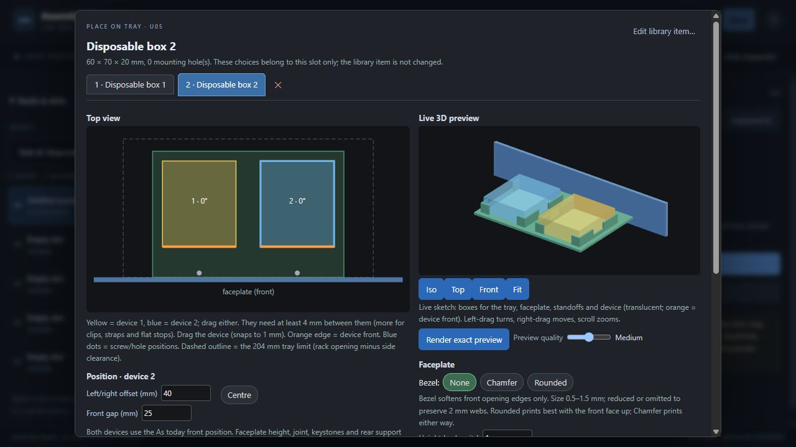
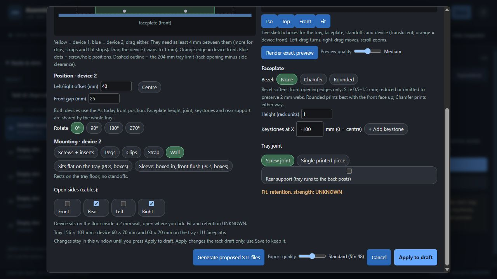

# Task 42 — wall around the device: implementation report

2026-10-24. Implemented locally in `D:\Projects\assembly-workshop`; awaiting Claude review. **The exact original Hue pair fixture is blocked by the required joint-clash check.** The supplemental renders below use a disclosed disposable offset adjustment. No physical approval.

## Scope and preservation

Read AGENTS.md, PROJECT.md, HANDOFF.md, ROADMAP.md and task 42 in the current D: project. The older C: checkout lacks task 42; its handoff points to D:. `git pull` in D: reported Already up to date. No commits, pushes, printing, publishing, uploads, purchases, releases, delegation or normal server restart. No new coupon or test-print ID (nothing intended for printing). Existing geometry, hardware revisions and user documents were preserved.

The explicitly requested read-only legacy library copy contains **9 current items**, rather than the older spec’s two. All nine were included. No tests ran against `data/normal-use`; no writes were made there. New render revisions and the synthetic browser database/rack/library live only in `work/wall-device-42/`. The original library file is only read for the requested copy. Existing unrelated untracked `work/gene-success/dishes.png` was untouched.

## Implementation

- `wall` accepted in Python and both JS mount maps. Wizard label: “Thin wall around it (boxes)”; Place on tray: “Wall”. Per-device side list defaults to rear, validates known sides and requires at least one open and one closed. Lists are canonicalized to front/rear/left/right. Device heights ≤2 mm are refused because the specified wall height would be nonpositive.
- The device uses the existing straps floor rule: floor bottom Z=8.225, top/device base Z=11.225 mm; no standoff. Wall geometry follows `dp` at 0/90/180/270°. SCAD device ghosts already use zero standoff for every mount other than inserts/pegs/clips, so no ghost-source edit was necessary. Python/JS lift, openings, clearance and cable markers treat wall as sitting on that floor. Wall does not gain strap slots.
- Wall: 0.5 mm nominal inner clearance per side; 2 mm thickness; `min(12, dev_h-2)` above floor. Open sides retain 10 mm measured along each inner corner edge; sides shorter than 30 mm omit their side wall entirely. Closed left/right sides of at least 40 mm have a centred 20 mm notch down to min(4,wall_h) above floor; short walls are never made taller by the notch. A 0.01 mm overlap joins the wall to the floor.
- Both devices get independent wall modules, opening lists and placement overrides via the existing second-device renaming path (`dev2_mount`, `dev2_wall_open`). Pair reach is 2.5 mm; mixing inserts/clips/pegs/straps is permitted subject to existing checks. Wall + flat remains refused by the existing shared-floor rule.
- Opt-in template block and reversed `wall_add` call use the established text-removal/substitution approach. All wall text is removed when neither device uses wall, including exact whitespace. No existing faceplate/keystone/slot/joint dimensions changed.
- Python, SCAD and JS test actual transformed wall boxes against the faceplate and final joint positions, after opening-driven joint movement and shared-pair sizing. The existing floor blocks/uprights occupy Y=0..11.3. Inspection also found the original tapered rail hull reaches Y=22; wall collision checks cover its X strips at joint X ±6, Y=9..22. This is conservative screening of the existing hull, not a change to that joint. Both single-piece and screw pairs check the faceplate.
- Place on tray shows four cable-side checkboxes and the specified UNKNOWN note for the active device. Sketch/rack preview includes wall returns, gaps and notch heights. Its orange front marker now rotates with the device-local front. Library defaults stay unchanged until an explicit library operation; Apply changes draft, Save persists it.

## Fixture conflict — reviewer action

The exact task Hue has `dev_off_y=1`: device front Y=13 and wall front Y=10.5..12.5. At joint X=−40 the front wall intersects the required Y=0..11.3 joint envelope. At 90° a wall side intersects it too. Both exact fixtures return: **“The wall would hit the faceplate joint; set the device back or move it sideways.”** They were not exported after failure. See `renders.json` first two entries.

Supplemental pair fixtures change only the Hue offset to `dev_off_y=13` (device front Y=25; nearest outer wall Y=22.5, 0.5 mm beyond the original rail envelope). The Pi example remains inserts at X=48, rotation 90°, including its original ports; keystone −100 stays. This is a test-only adjustment, not a silent correction of Brian’s library item. Acceptance (b)/(c) cannot be claimed for the literal spec fixture; Claude should review the test position before rebuilding the real item.

## Commands and results

- `powershell -NoProfile -ExecutionPolicy Bypass -File outputs\Mechanical_Design_App\run_checks.ps1`: **PASS — 216 Python tests, 2 expected render-suite skips; 243 JavaScript tests, zero failures.** Final log: `work/wall-device-42/checks-complete.log`. The skipped suites are the opt-in keystone sweep and wall-box sweep, unrelated to this device wall. Six new Python tests and six new JS tests cover acceptance, side validation, floor/port behavior, collision guards, rotation, returns/notches, pair reach, independent settings, mixed mounts, legacy hashes and single-piece pair guarding.
- Existing archived-template loops now explicitly exclude wall (the archived adapters never supported it); allocation-key expectation adds wall_open. This preserves their purpose. The first check run exposed those old assumptions; `checks.log` retains that diagnostic run. Later complete runs passed.
- `python -B work/wall-device-42/scripts/task42_render.py`: explicit exact renders via `OpenSCAD.exe`, app render/strict mesh pipeline on NEW render-data. Four successful cases / eight part meshes, all closed with consistent winding, positive volume and zero nudge. No release/export zip or real library rebuild. Initial SCAD membership failure retained in `renders-initial-failure.log`; corrected before successful renders.
- `python -B work/wall-device-42/scripts/task42_extra_verify.py`: PASS. 48 Python/JS wall-box cases agree to 1e-8 mm (all sides and rotations, dimensions at 29/30 and 39/40 thresholds, heights 3/8/25.4); direct OpenSCAD CSG assertion checks reject none-open, all-open, unknown sides and joint clash. These failed cases generate diagnostic CSG only, never proposed STL exports. Final legacy comparison 20/20 unchanged. Measured notch/thickness/returns from exact STL planes. Browser saved arrays were checked from the disposable rack file, with synthetic library defaults still straps.
- `git diff --check`: PASS (only Git’s normal LF/CRLF conversion notices). No staging, commit or push.

## Exact render measurements

All dimensions below come from the generated tray STL, transformed back into the Hue device-local frame. Horizontal mesh sections below the notch determine the wall inner planes; a section through rear returns at floor+6 determines the gap. Plane measurements at floor+4 determine the finger notch. Detailed sections, bounds, volumes and hashes are in `renders.json`, per-render `revision.json`, and `extra-measurements.json`.

| Case | Hue offset Y | Wall height | Inner W × D | Rear open gap | Tray/faceplate | Nudge |
| --- | ---: | ---: | --- | ---: | --- | --- |
| single | 13 | 12 mm | 91.7 × 91.4 mm | 71.7 mm | closed / closed | {'tray': 0, 'faceplate': 0} |
| pair | 13 | 12 mm | 91.7 × 91.4 mm | 71.7 mm | closed / closed | {'tray': 0, 'faceplate': 0} |
| pair90 | 13 | 12 mm | 91.7 × 91.4 mm | 71.7 mm | closed / closed | {'tray': 0, 'faceplate': 0} |
| second-wall | 13 | 12 mm | 91.7 × 91.4 mm | 71.7 mm | closed / closed | {'tray': 0, 'faceplate': 0} |

The extra `second-wall` render places the Hue wall on device 2 and the Pi on device 1 to verify the renamed geometry. Wall thickness **2.000 mm**; nominal case-to-wall offset **0.500 mm** on each measured side; returns **10.000 mm** along the inner edge; finger notch **20.000 mm** wide with bottom **4.000 mm** above floor. Each full wall top is Z=23.225 mm. These are digital measurements, not physical tolerance evidence.

## Browser acceptance

Fresh browser session explicitly approved by Brian. Used the computer-use skill and a new server at **http://127.0.0.1:8872**, then stopped only that process after verifying its command line. The browser tab was closed. No normal-use browser or app server was controlled.

Clicked the synthetic pair → Place on tray → Wall on device 1, confirmed default Rear and opened Front; switched to device 2 → Wall, confirmed its independent default Rear and opened Right; switched back to confirm device 1 still Front+Rear. Both 3D walls/gaps were visible. Apply produced Unsaved changes; explicit Save produced Saved locally. Disk verification shows independent `placement.tray.wall_open=["front","rear"]` and `placement.second.tray.wall_open=["rear","right"]`. Both library defaults remain straps. Browser warning/error log was empty. No render/export button was clicked in the browser.

Evidence: `browser/task42-browser-device1.txt`, `browser/task42-browser-device2.txt`, `browser/task42-browser-saved.txt`, and screenshots below.

## Legacy generated-source SHA-256 (UTF-8)

Captured with the original code before any app edit; compared after final changes using `eq.source(eq.clean(spec))`. Includes every current example, every item in the explicitly requested read-only library copy, all seven task-41 coupon JSONs, plain sleeve, flat and a two-device pair. Full raw fixtures and hashes: `legacy-before.json` / `legacy-results.json`. All 20 pairs match.

| Fixture | Before SHA-256 | After SHA-256 |
| --- | --- | --- |
| example:Raspberry Pi 4 (example) | `fe6bff2a485ce7814614000a90da9c6679509ed8b4b69dd5d6dac30023f6baec` | `fe6bff2a485ce7814614000a90da9c6679509ed8b4b69dd5d6dac30023f6baec` |
| library:Raspberry Pi 4 (example) | `fe6bff2a485ce7814614000a90da9c6679509ed8b4b69dd5d6dac30023f6baec` | `fe6bff2a485ce7814614000a90da9c6679509ed8b4b69dd5d6dac30023f6baec` |
| library:Dell OptiPlex Micro 7010 (sleeve) | `fcb9dff6521aaa19ec3753e7781fd80968556b0f70d6663181bfcef44be751e3` | `fcb9dff6521aaa19ec3753e7781fd80968556b0f70d6663181bfcef44be751e3` |
| library:Drive tray (3.5" HDD + 2.5" SSD) | `3297879222e50ed29b4a51dcc9ea8518a326ef2e217f4fc07f27b30240562a4e` | `3297879222e50ed29b4a51dcc9ea8518a326ef2e217f4fc07f27b30240562a4e` |
| library:7" touch screen plate (placeholder) | `2046c1b868b97fee6086d32a6624dffc2ccdf1685b9c15af4d2708fa05a25745` | `2046c1b868b97fee6086d32a6624dffc2ccdf1685b9c15af4d2708fa05a25745` |
| library:Keystone panel, 10 (3 USB, 4 LAN, 3 blank) | `2a641ad48c0a91ea8649abebe33a2d6b3ce556039f36bb23b2d3af4d4b173635` | `2a641ad48c0a91ea8649abebe33a2d6b3ce556039f36bb23b2d3af4d4b173635` |
| library:TP-Link TL-SG108E | `8252da3ca3388b62cc2033c067866604e6f9efb072810d4c19ac83ae31beb26b` | `8252da3ca3388b62cc2033c067866604e6f9efb072810d4c19ac83ae31beb26b` |
| library:Modem ECB7250 (placeholder) | `733df8f95e2d357cfd9848858db6b9c3e20abf346619d0150108599493efdb77` | `733df8f95e2d357cfd9848858db6b9c3e20abf346619d0150108599493efdb77` |
| library:Netgear CM1000 (bracket: faceplate + rails v2) | `37de9848c08753bdc88d624a3c0615aa66412defb78c942c9b0f053d4fbef9f8` | `37de9848c08753bdc88d624a3c0615aa66412defb78c942c9b0f053d4fbef9f8` |
| library:Philips Hue Bridge + Raspberry Pi 4 (keystone) | `e11808e70687dbb850d2bbf75b26f76dc3c57f4f42750ce9f682f1428218cc59` | `e11808e70687dbb850d2bbf75b26f76dc3c57f4f42750ce9f682f1428218cc59` |
| SLV-A_spec | `488c89c99fa3d55068e17f8944b3d3c8d5d17b7b962574aee66d6964dd1ac605` | `488c89c99fa3d55068e17f8944b3d3c8d5d17b7b962574aee66d6964dd1ac605` |
| SLV-B_spec | `4abc4027b7de883382ed53880e2fd63b2fe3542b09f5d10dd5a1ed1d11c1c857` | `4abc4027b7de883382ed53880e2fd63b2fe3542b09f5d10dd5a1ed1d11c1c857` |
| SLV-C_spec | `4abc4027b7de883382ed53880e2fd63b2fe3542b09f5d10dd5a1ed1d11c1c857` | `4abc4027b7de883382ed53880e2fd63b2fe3542b09f5d10dd5a1ed1d11c1c857` |
| SLV-D_spec | `73f1e7242e08eed5fc5a15fdee612293f14fc38f55cc85b900ee53a4dc71d766` | `73f1e7242e08eed5fc5a15fdee612293f14fc38f55cc85b900ee53a4dc71d766` |
| SLV-E_spec | `4bb7976e7b1934828f3a49019eccaadf92f2d493609776dde38e219909bb5299` | `4bb7976e7b1934828f3a49019eccaadf92f2d493609776dde38e219909bb5299` |
| SLV-F_spec_O | `a0fdaf7fc626c273f6ee04cd5c69ef01977c98305c0a70b1b35cc581f9ef9da8` | `a0fdaf7fc626c273f6ee04cd5c69ef01977c98305c0a70b1b35cc581f9ef9da8` |
| SLV-F_spec_R | `7e85f20cb640347fde958e568d76f926f8c3c4c11427797cb4a1c5fa3c160b5b` | `7e85f20cb640347fde958e568d76f926f8c3c4c11427797cb4a1c5fa3c160b5b` |
| plain sleeve | `43974bc6d28420146f5a3d5fdd25cc9f5f78b612257f4c9f28cbbb5491a76a57` | `43974bc6d28420146f5a3d5fdd25cc9f5f78b612257f4c9f28cbbb5491a76a57` |
| flat | `1ff597258691a8547f2ec4bb75142225032a35edc698a40e5417e7d26a0bc6e1` | `1ff597258691a8547f2ec4bb75142225032a35edc698a40e5417e7d26a0bc6e1` |
| pair | `37fb47218537f1ed1af1f5ba98f21f0582ff1ad5d46c6bf79abf78311fe0dce7` | `37fb47218537f1ed1af1f5ba98f21f0582ff1ad5d46c6bf79abf78311fe0dce7` |

## Files changed and SHA-256

File hashes below normalize CRLF to LF, so Git’s Windows line-ending conversion cannot masquerade as a code change. Before = clean session HEAD (starting status contained only unrelated untracked dishes.png); raw backups of the eleven primary app files also exist in `before-files/`. Generated-source hashes above use the exact produced UTF-8 bytes. NEW means absent before this task. The early failed check scratch directory was preserved by moving it from work/gui-refinement/checks-fe3twug_ into work/wall-device-42/failed-check-scratch. Evidence files are all new under `work/wall-device-42/`; `evidence-hashes.json` inventories them. The report itself is new.

| File | Before (LF-normalized) | After (LF-normalized) |
| --- | --- | --- |
| HANDOFF.md | `0fe4198fc729c29d7094933708af67f2e70c16ac9ed1179f4b90a5adf0c067f0` | `060cbc1c83c7f770db9d17b2fdc49292905d3e78b40957e13db6c7ad60df2b01` |
| outputs/Mechanical_Design_App/equipment.py | `210a06905273d46201f0a516b3bc7f640105be7637e5a9c38a6524a3cae74e69` | `679bc4a8b32f472c1d87f5835ba5e637070fc8162148d4092e9b7348650fc0c6` |
| outputs/Mechanical_Design_App/equipment_tray.scad | `095450832fb0b1565d18beccc4197e4aec70cc2b72f8129c15555ce17374aaf4` | `680c712766c5167ba250e243f981047480e0d77f6ac9f76986ae5e1808873180` |
| outputs/Mechanical_Design_App/port_openings.py | `396871033551251096ab168a763986c792d3533f4581045ba1884d28693df8da` | `668b800876c43d9e76323a2fc5b3a0aba115bdd76b1ad12f8792830f5955cf1b` |
| outputs/Mechanical_Design_App/port-openings.js | `4f67de47b5a1ee91cf286873aefd995555550a97ce8ec5a48030229784a77dd4` | `384aa00f93514ca5fb8e4eac68e53a576e412f10b2b9ccbcd09306214b4af12e` |
| outputs/Mechanical_Design_App/clearance.js | `e904583f4d5d06101d310ed5773e79842038fc688a17dbe16e43140e1d9b8e52` | `c623a8f93ed0431fa0078ae639e8553a0e0117f90a451964929fdd7bcd96f374` |
| outputs/Mechanical_Design_App/cable-ports.js | `74d17f28260f1356b86b9fba8568719d63770d2b9d84a64a9a1fa80dd925fec5` | `e3f295b995bde5623e7de37851d602d2f9fffd30e4eb6942d55225e91efa8906` |
| outputs/Mechanical_Design_App/equipment-wizard.js | `1dbda077bdc029d7f4209142752178f41a03871eca0a661e34c1beb8b74b7c60` | `ad5b9617369c5150e2096ff6a74567048d1ad0bebfc46db7c98bc3f8f8c850ca` |
| outputs/Mechanical_Design_App/tray-placement.js | `94755cf33c3de1db76a8e1962983a8dc2c666428d03da68dc67fe6b33175061c` | `70dd983c65ba5f67335dcb12e3c96fed712f43924a916ce28a610ae6a06eb3e9` |
| outputs/Mechanical_Design_App/tray-pair.js | `2b7bab0943706879583178c73ae801fe2d81b392eec66f28364f99fe349b61e1` | `3928a0f81638240f40f92e9e2c531e86baeb27de930ac1dfdb44c0a3f91f7ce1` |
| outputs/Mechanical_Design_App/asset-manifest.json | `31094e6ccdc517ef0df3e002f889f91b869e29b87044e1da6d7c214d29a3c7d1` | `9cb1c3b373dfa8af788930a437782df828db61f17eaed21a472f7949a7e3da59` |
| outputs/Mechanical_Design_App/test_wall_mount.py | `NEW` | `d91ab105367ec4f5fc369e27aa7402f2fb25dc7514de5ef9c87ecc8b7105cedf` |
| outputs/Mechanical_Design_App/js-tests/wall-mount.js | `NEW` | `e8f2ab75af627c2a4cdd5f0633b12e92562e269dfb0cba8133890cc10f3652b8` |
| outputs/Mechanical_Design_App/test_allocation_tray.py | `95ca52ab771f5df00ec0781edbb35efc7b21db9d36b09fad47f06a8b30194970` | `5ef8836ad39cff9708ecdc7217afbeb56f028498e4ab41647378653787a0893e` |
| outputs/Mechanical_Design_App/test_tray_placement.py | `8b0dc4a63893f35a1f081e68d7260cb48d8a704241253915cbdc2668db14ccef` | `29ca0eeed694df553ac673075a7308e3ce3e5d96df03b59aa82a89f15f4e3478` |
| outputs/Mechanical_Design_App/run_checks.ps1 | `16c78e434e198d990a8608c055560ad00e3620df43889f472cee9774203ce8e1` | `a799eefaa477a093a4d921211a79e80209f9b39ad7dcf70bcfc2048545bcc6ab` |
| work/gui-refinement/check_python.py | `ea41405fd2daebc1973280ca418f5a8c3bfe7678f5b0ac24d80cd1f37c6c1508` | `ff9b843eb61f8e9d4b1897d6210d72cf9a45d413dc40cc3543899258d93f9806` |

## UNKNOWNs and limits

- Physical fit at 0.5 mm nominal clearance, actual Hue case dimensions/tolerances, printed shrinkage and surface finish: UNKNOWN. No physical sample was made or handled.
- Retention against lift-out, sliding, vibration or cable pull: UNKNOWN. A wall has open sides and finger notches; it is not a certified latch.
- Wall/floor/joint strength, stiffness, fatigue, loads, long-term creep, installation safety and suitable printing process/material settings: UNKNOWN. Digital closure is not physical approval.
- Real cable/connector access and bend room on every chosen device-local open side, especially after 90° rotation or alongside the other device: UNKNOWN. Selecting a side is not automatic port detection or a cable clearance guarantee.
- Real finger access and ease of device removal: UNKNOWN. Digital notch size is measured; usability is untested.
- Shared-tray stability, adjacent equipment/rack service space, hardware engagement and usable rack depth beyond documented nominal screening: UNKNOWN. Existing constraints/UNKNOWNs remain.
- Joint collision screening uses the actual transformed wall boxes and conservative planar envelopes of the current blocks/rails; it does not certify physical clearances or all future template changes. The original task pair is intentionally blocked.
- Browser acceptance used synthetic 60 × 70 × 20 mm devices; exact STL measurements used the nominal Hue example. The actual saved Hue+Pi library item was not rebuilt, repinned or altered. No claim of full literal-fixture acceptance for (b)/(c).

Claude reviews this report and the disclosed fixture conflict before rebuilding the real library item.
