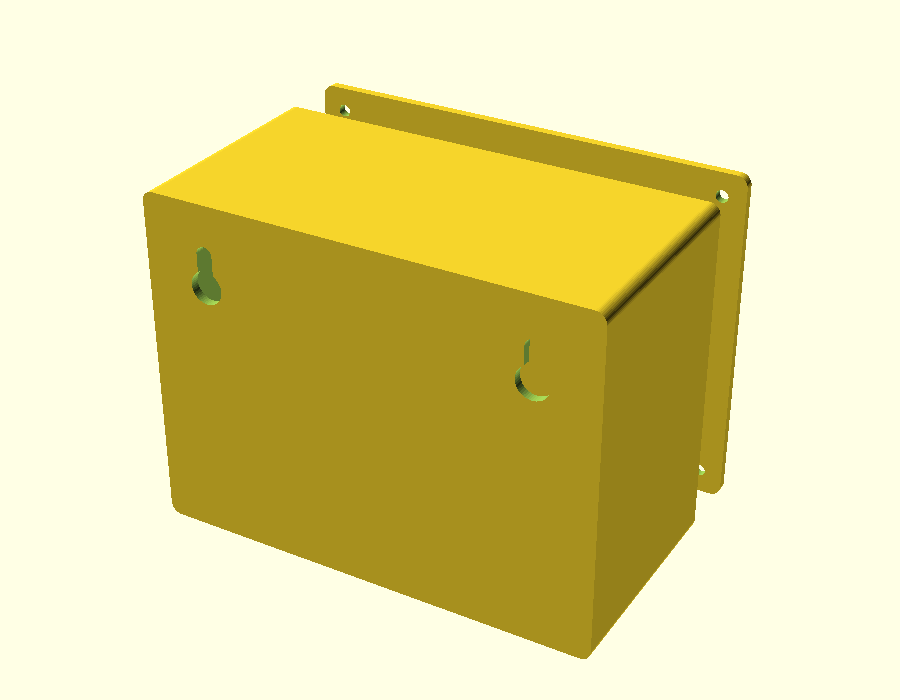
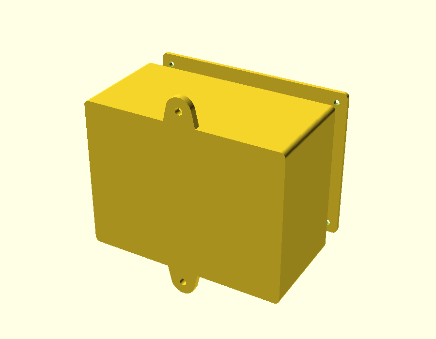
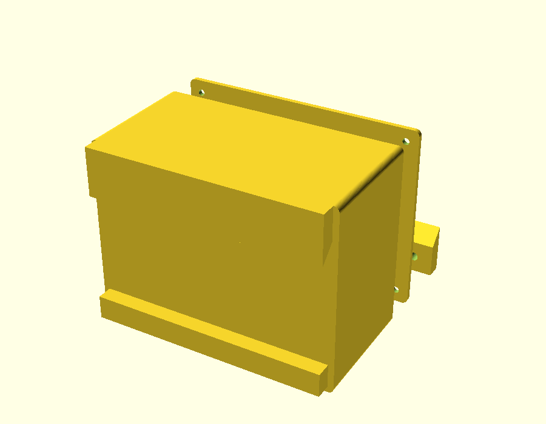
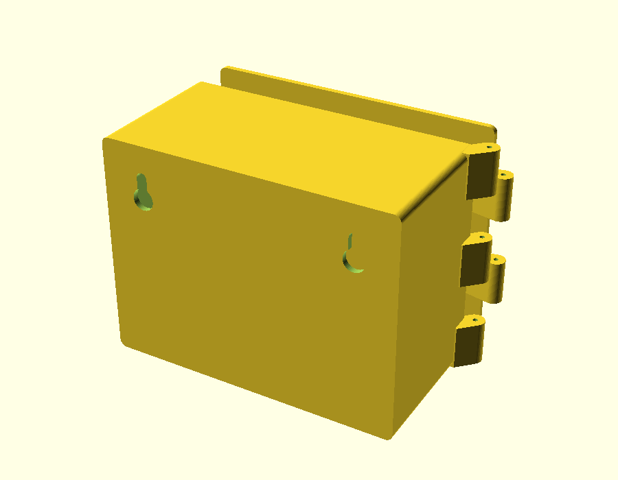
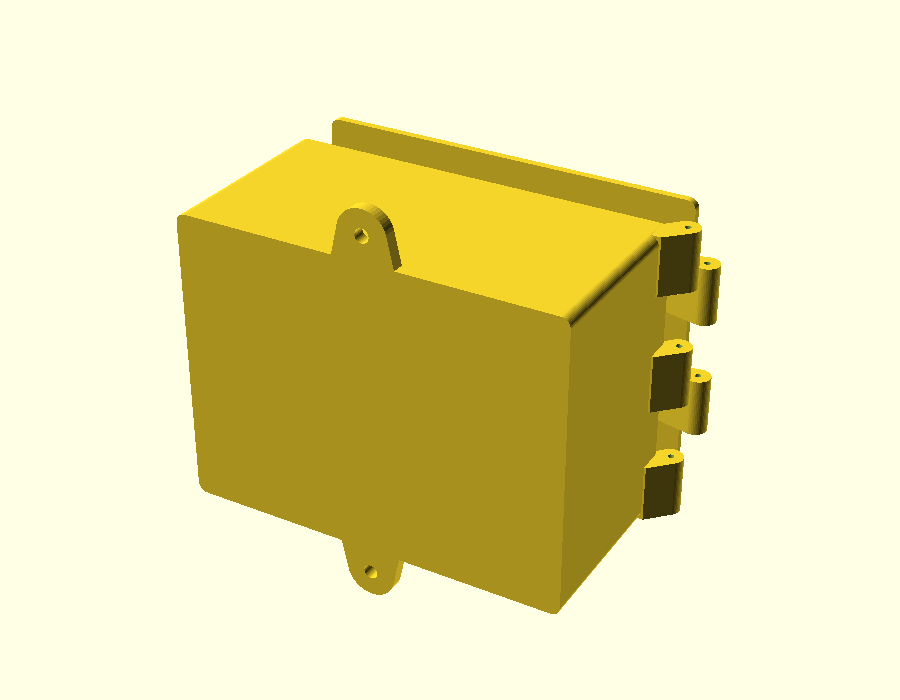
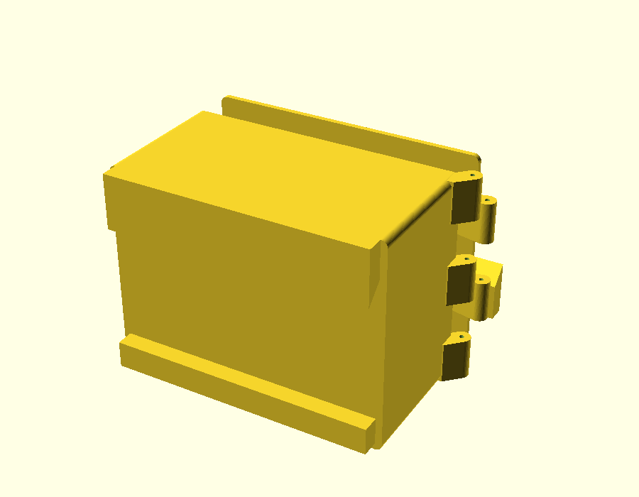
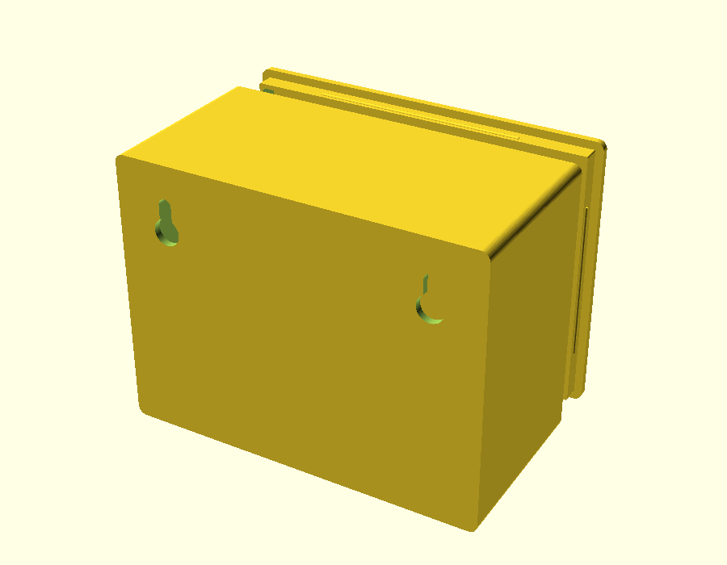
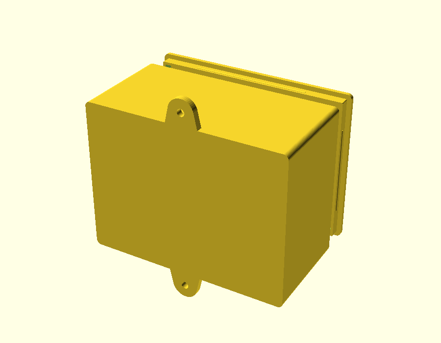
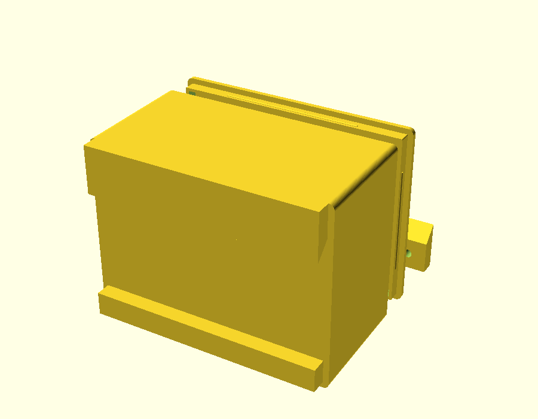
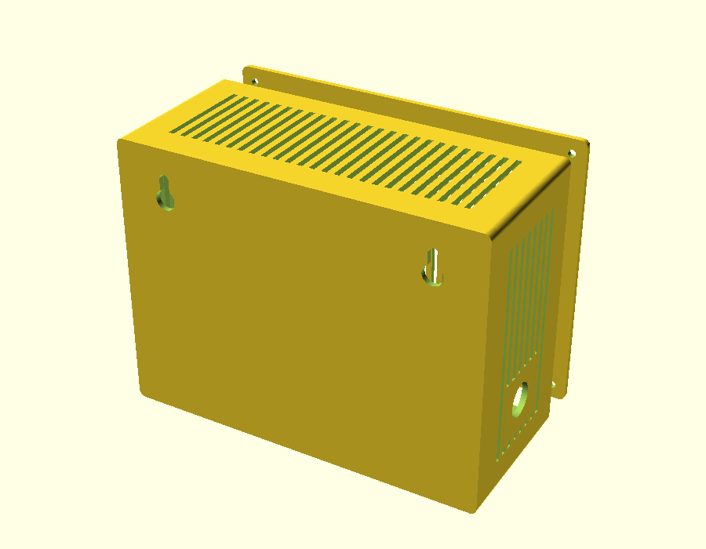

# Task 38 · Wall-mount box template — report

2026-10-22. Built by Claude in the coordinator session (Brian: "codex is tired, we'll run this one ourselves"). Spec: [38-wall-box-template.md](../codex-tasks/38-wall-box-template.md). **PROPOSED — UNVALIDATED:** fit, hinge/latch/snap function, wall-mount load and strength UNKNOWN. Nothing printed. No existing template, spec, saved data or export changed.

## What exists

- `wall_box.scad`: body, lid and (cleat mount) wall rail. Lid: screw (M3 insert bosses, 4.0 pilot = the printed Pi4 joint pilot, 3.4 clearance), hinge (5 knuckles, 1.75 mm filament pin in a 2.0 hole, ramp latch on the far side), snap (lip with beads into wall grooves). Mount: two keyholes, top/bottom tabs, or a 45° French cleat with a matching rail. Slot vents per wall. Cutouts: golden keystone (geometry read from `equipment_tray.scad` at generate time, so one copy; ks_tight 0.2), PG7/PG9, round, rect. Standoffs on the inside back.
- `wall_box.py`: validation with plain messages (250 mm outer limit counting lid and mounts, 2 mm margins, overlaps, box-feature keep-outs, unknown keys), deterministic SCAD output, CLI `python wall_box.py spec.json out.scad [part]`.
- `wall_box_parts.json`: keystone, PG7, PG9; barrel jack, USB-C panel, rocker switch and **ScreenBeam ECB7250 have no size (UNKNOWN)** and are refused until measured.
- Change from the spec: vents never fail validation; they step around cutouts, standoffs and box features (3 mm gap) automatically.

## Checks

- `run_checks.ps1`: all pass (210 Python, 2 skipped; JS all pass). New `test_wall_box` (9 tests) registered in `work/gui-refinement/check_python.py`.
- `AW_RENDER_TESTS=1 python -m unittest test_wall_box.WallBoxRenderTests`: all 9 lid × mount combinations render closed (OpenSCAD 2021, `C:/Program Files/OpenSCAD/openscad.exe`).

## Renders (120 × 60 × 90 inner, wall 2.5; "loaded" = 160 × 70 × 120 with vents, 2 keystones, PG9, 4 standoffs)

| Case | Part | Closed | Volume mm³ | Triangles | s |
|---|---|---|---:|---:|---:|
| screw-keyhole | body | yes | 95648.32 | 2276 | 4.9 |
| screw-keyhole | lid | yes | 29577.45 | 988 | 1.7 |
| screw-tabs | body | yes | 97952.55 | 2316 | 4.8 |
| screw-tabs | lid | yes | 29577.45 | 988 | 1.6 |
| screw-cleat | body | yes | 127526.93 | 1768 | 3.9 |
| screw-cleat | lid | yes | 29577.45 | 988 | 1.6 |
| screw-cleat | cleat | yes | 19656.74 | 788 | 1.6 |
| hinge-keyhole | body | yes | 97499.03 | 1916 | 3.6 |
| hinge-keyhole | lid | yes | 32649.62 | 892 | 1.6 |
| hinge-tabs | body | yes | 99803.26 | 1956 | 3.4 |
| hinge-tabs | lid | yes | 32649.62 | 892 | 1.6 |
| hinge-cleat | body | yes | 129377.64 | 1408 | 2.9 |
| hinge-cleat | lid | yes | 32649.62 | 892 | 1.6 |
| hinge-cleat | cleat | yes | 19656.74 | 788 | 1.6 |
| snap-keyhole | body | yes | 93111.73 | 1284 | 2.9 |
| snap-keyhole | lid | yes | 33756.79 | 1020 | 3.9 |
| snap-tabs | body | yes | 95415.96 | 1324 | 3.0 |
| snap-tabs | lid | yes | 33756.79 | 1020 | 3.8 |
| snap-cleat | body | yes | 124990.34 | 776 | 2.4 |
| snap-cleat | lid | yes | 33756.79 | 1020 | 3.8 |
| snap-cleat | cleat | yes | 19656.74 | 788 | 1.6 |
| loaded | body | yes | 139530.1 | 6228 | 15.3 |
| loaded | lid | yes | 36452.45 | 1488 | 2.4 |

| Case | Outer X × Y × Z mm (lid, hinge/latch, mounts included) |
|---|---|
| screw-keyhole | 125 × 65 × 95 |
| screw-tabs | 125 × 65 × 127 |
| screw-cleat | 125 × 73 × 95 |
| hinge-keyhole | 136.7 × 65 × 95 |
| hinge-tabs | 136.7 × 65 × 127 |
| hinge-cleat | 136.7 × 73 × 95 |
| snap-keyhole | 125 × 65 × 95 |
| snap-tabs | 125 × 65 × 127 |
| snap-cleat | 125 × 73 × 95 |
| loaded | 165 × 75 × 125 |

         

## Files

| File | SHA-256 |
|---|---|
| `outputs/Mechanical_Design_App/wall_box.scad` | `536bb346f7c8faa100dc1a20b016a996c1bfbd77102fbc3d047779406855216f` |
| `outputs/Mechanical_Design_App/wall_box.py` | `25a1c28945006266ce1459d34dfc053fd0f566993051d16501f16eccb66cbf3c` |
| `outputs/Mechanical_Design_App/wall_box_parts.json` | `05484e91e24424f9d2f20d1b1e70cf040b96c80f6bfab7f35fb02a25cc21286d` |
| `outputs/Mechanical_Design_App/test_wall_box.py` | `82f0fb5e448cd244a3ae82507b18b69b3393f9647ddd3668c237bd7b5696676c` |
| `work/gui-refinement/check_python.py` | `ea41405fd2daebc1973280ca418f5a8c3bfe7678f5b0ac24d80cd1f37c6c1508` |

## Open questions

- ECB7250 size and port positions (Brian to measure).
- Hinge pin choice (1.75 filament vs M3 rod) and latch force: UNKNOWN until printed.
- Gland nut keep-out (+8 mm) is an estimate.
- Next: wizard GUI (separate wizard page) and STL export route; then a first test print only at Brian's direction (with a test print ID on the part).
